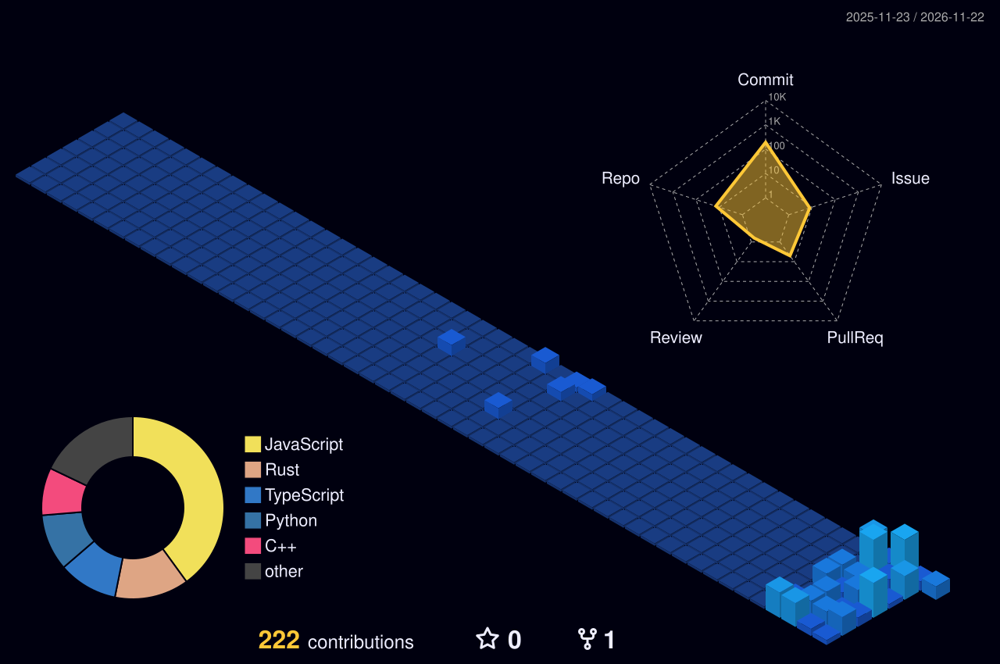

<!-- Profile README for Panz-08. Contribution visuals are generated automatically. -->

# Panz-08

Full-stack developer based in Bogor, Indonesia. I build web applications, APIs, and games, with an emphasis on automation and developer tooling.

- **Currently building:** [Lembar](https://github.com/Panz-08/Lembar-Komik-UI) - comic and novel reader
- **Recently shipped:** [Sorcerer](https://github.com/Panz-08/sorcerer) - terminal file and document converter
- **Focus:** Full-stack development, API engineering, game development
- **Learning:** Rust, Next.js, TypeScript, Godot
- **Stack:** TypeScript, JavaScript, Node.js, Express, PHP, Python, Rust, React, Next.js, MySQL, PostgreSQL, Godot

## Contribution Activity

  

  <picture>
    <source media="(prefers-color-scheme: dark)" srcset="https://raw.githubusercontent.com/Panz-08/Panz-08/main/profile-3d-contrib/profile-night-view.svg" />
    <source media="(prefers-color-scheme: light)" srcset="https://raw.githubusercontent.com/Panz-08/Panz-08/main/profile-3d-contrib/profile-green.svg" />
    
  </picture>

  
  

  

## Selected Projects

| Project | Description | Stack |
| --- | --- | --- |
| [Sorcerer](https://github.com/Panz-08/sorcerer) | Terminal file and document converter with a ratatui interface, 44 formats, PDF merging, and parallel batch processing. | Rust, ratatui |
| [Lembar](https://github.com/Panz-08/Lembar-Komik-UI) | Comic and novel reader with a clean reading interface and full chapter text. | Vite, JavaScript, Vercel |
| [Komik API](https://github.com/Panz-08/komik-api-pengembangan) | Multi-source comic API and Sakuranovel novel API with chapter text. | Express 5, JavaScript, Vercel |
| [Panzki Browser](https://github.com/Panz-08/panzki-browser) | Interactive web browser for the terminal, written in Rust. | Rust |
| [Web-Based Strategy Game](https://github.com/Panz-08/Web-Based-Strategy-Game) | Real-time 2D territory strategy game for the browser, with bot matches and P2P multiplayer. | TypeScript |
| [Unciv God Mode](https://github.com/Panz-08/unciv-panz08-god-mode) | Sandbox mod for Unciv with custom civilizations, units, buildings, and accelerated economy. | JavaScript, Unciv |
| [Wibu CLI](https://github.com/Panz-08/wibu-cli) | Anime streaming client for the terminal that plays subbed streams in MPV. | Rust, MPV |
| [Sakuranovel API](https://github.com/Panz-08/sakuranovel-api) | Metadata and chapter list API for Sakuranovel, ready to deploy on Vercel. | JavaScript, Vercel |

More repositories: [github.com/Panz-08?tab=repositories](https://github.com/Panz-08?tab=repositories)

## Contact

- GitHub: [github.com/Panz-08](https://github.com/Panz-08)
- Issues: [github.com/Panz-08/Panz-08/issues](https://github.com/Panz-08/Panz-08/issues)

---

Profile activity is updated automatically via GitHub Actions.

